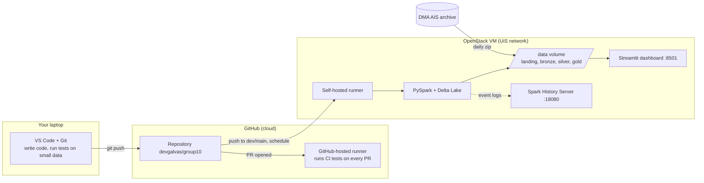
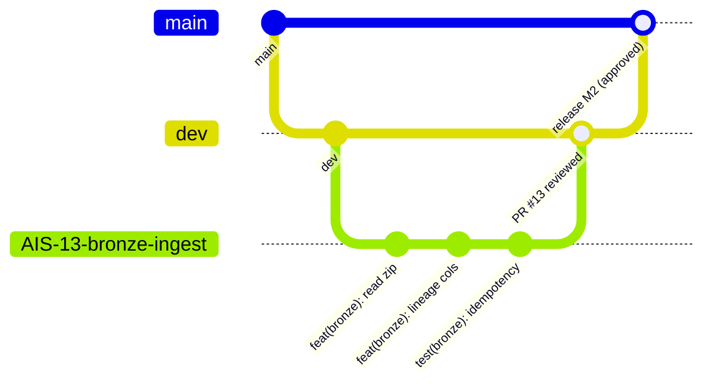
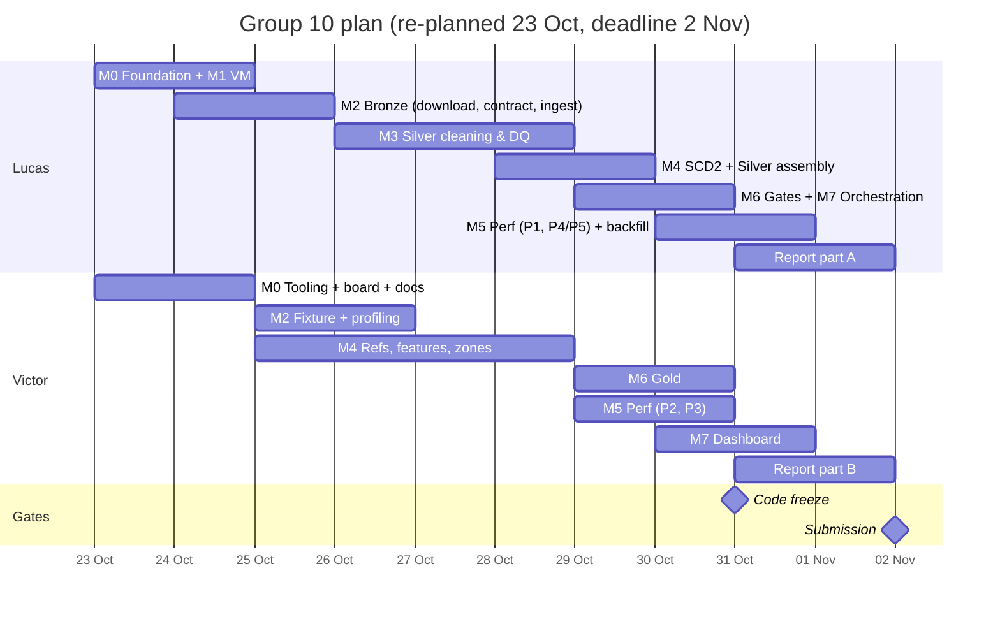

# Team Guide — Maritime Traffic & Port Congestion Pipeline

**DAT535 · Group 10 · Lucas Galvão Freitas & Victor Peugnet**

This is our shared handbook. It explains **what** we are building, **where** each piece runs, **how** we work together on GitHub, and **who** does what until the deadline (**Mon 2 Nov 2026**).

> **Status update, 8 Nov 2026.** Victor left the project on 2 Nov 2026; Lucas owns every issue.
> The deadline moved: the presentation is on **Mon 16 Nov 2026** and the report is due about a
> week later. The owners and dates below are the original plan, kept as a record of how we
> planned. The live status is on the GitHub issues.

If you only read one section today, read [§5 Our daily workflow](#5-our-daily-workflow-one-issue-from-start-to-finish).

---

## Contents

1. [The project in plain words](#1-the-project-in-plain-words)
2. [Architecture: what runs where](#2-architecture-what-runs-where)
3. [Glossary](#3-glossary)
4. [Setting up your machine](#4-setting-up-your-machine)
5. [Our daily workflow (one issue from start to finish)](#5-our-daily-workflow-one-issue-from-start-to-finish)
6. [GitHub Issues, labels, milestones and the Project board](#6-github-issues-labels-milestones-and-the-project-board)
7. [GitHub Actions explained from zero](#7-github-actions-explained-from-zero)
8. [Who does what: the workload split](#8-who-does-what-the-workload-split)
9. [Timeline](#9-timeline)
10. [Team rules and collecting evidence for the report](#10-team-rules-and-collecting-evidence-for-the-report)
11. [Troubleshooting](#11-troubleshooting)

---

## 1. The project in plain words

### What is AIS?

Every large ship carries a radio transponder called **AIS** (Automatic Identification System). Every few seconds it broadcasts:

- **who** the ship is: its MMSI number, name and type;
- **where** it is: latitude and longitude;
- **how** it is moving: speed, course and heading.

Coastal stations receive these messages. The Danish Maritime Authority (DMA) publishes **one CSV file per day** with every message heard around Denmark. Each file holds 1.5–2.6 GB of text and over ten million rows.

### What problem do we solve?

The raw files are messy:

- the same message appears several times, because several stations heard it;
- some rows come from lighthouses and base stations, not ships;
- some positions are impossible (latitude 91);
- ship names and types change over time.

You cannot answer simple questions directly from that mess.

We build a **pipeline**: a chain of automated steps that cleans the data and turns it into two small, trustworthy tables. They answer:

1. **How congested is each port, hour by hour?** That is, how many ships are in port and how many are waiting at anchor.
2. **How long do ships stay in port, by ship type?**

The three ports are **Esbjerg (DKEBJ), Aarhus (DKAAR) and Copenhagen (DKCPH)**. A small dashboard shows the results.

### The Medallion Architecture

The course asks us to organise data in three layers, like medals:

| Layer | Purpose | Our tables |
|---|---|---|
| **Bronze** | Keep the raw data exactly as received, plus a note of where it came from | `bronze.ais_raw` (every column as text) |
| **Silver** | Clean, validate, standardise and enrich. **Most of the grade is here** | `silver.vessel_position`, `silver.dim_vessel`, `silver.dim_port`, `silver.rejects` |
| **Gold** | Small tables built to answer one question | `gold.port_calls`, `gold.port_congestion_hourly` |

Next to the layers sit **ops** tables, which record what the pipeline did:

- `ops.ingestion_log`: which files were loaded;
- `ops.dq_metrics`: data-quality counts before and after cleaning;
- `ops.pipeline_runs`: every run, with its status and row counts;
- `ops.perf_results`: our performance experiments.

### What the teacher grades

The guide says an **A** is "outstanding and clearly distinctive, with very strong judgement and independence". For us, that means:

- **Evidence beats claims.** Every optimisation is measured before and after. Every cleaning rule is counted.
- **Explain decisions.** We keep a decision log (`docs/decisions.md`) as we go, so the report almost writes itself.
- **It runs end to end, automatically**, and another engineer could reproduce it.

---

## 2. Architecture: what runs where

There are three places code runs. Mixing them up causes most beginner confusion.



| Place | What it is | What we do there |
|---|---|---|
| **Your laptop** | Your own computer | Write code, run unit tests on tiny fake data, commit, push |
| **GitHub** | Stores the code and runs automation | Pull requests, reviews, issues, the board, CI tests on GitHub's own machines |
| **The VM** | Our OpenStack virtual machine (4 vCPU, 8 GB RAM), reachable only from the UiS network | Stores the real data and runs the real pipeline, the scheduled jobs and the dashboard |

**Why the VM?** Real AIS data is about 2 GB per day. GitHub's free machines are too small and temporary for it. The VM was already prepared in Labs 1–3: Spark, Java and Python are installed, and the GitHub runner is registered. We add a **300 GB block-storage volume** (our quota allows 1 TB), mounted at `/data`, for the data lake.

### Folder layout on the VM

```
/data/
├── ais/
│   ├── dev/                 # the dev environment: small sample, safe to break
│   │   ├── landing/         # downloaded zips
│   │   └── lake/            # bronze/ silver/ gold/ ops/  (Delta tables)
│   └── prod/                # the production environment: the full 4-week window
│       ├── landing/
│       └── lake/
└── spark-events/            # Spark event logs, read by the History Server
```

### Folder layout of the repository (target)

```
group10/
├── src/ais_pipeline/        # our Python package (all pipeline code)
│   ├── cli.py               # one command-line entry point
│   ├── config.py  spark.py
│   ├── ingest/              # download + bronze
│   ├── silver/              # cleaning, rules, dims, features
│   ├── gold/                # port calls, congestion, quality gates
│   └── ops/                 # run log, dq metrics
├── ref/                     # small reference CSVs (ports, ship types)
├── config/                  # dev.yaml, prod.yaml, ci.yaml
├── tests/                   # pytest tests + tiny fixture data
├── perf/                    # performance experiments
├── dashboard/               # Streamlit app
├── docs/                    # this guide, decisions, profiling, performance
├── labs/                    # old lab files (kept for history)
└── .github/workflows/       # ci.yml, dat535-dev.yml, dat535-prod.yml, scheduled.yml
```

---

## 3. Glossary

| Term | Meaning, in one or two lines |
|---|---|
| **Spark / PySpark** | A system that splits big data into pieces (partitions) and processes them in parallel. PySpark is its Python interface. |
| **DataFrame** | A table in Spark. You transform it with `select`, `filter`, `withColumn`, `groupBy`… |
| **Lazy evaluation** | Transformations only build a plan. Nothing runs until an **action** (`count`, `write`, `collect`). |
| **Partition** | One chunk of a DataFrame, processed by one task. On disk, a folder such as `date=2025-09-01/`. |
| **Shuffle** | Moving data between partitions (needed by `groupBy` and `join`). Slow and expensive, so we try to reduce it. |
| **Broadcast join** | Sending a small table to every worker, so the big table does not need a shuffle. |
| **Skew** | Some keys have far more rows than others, so one task runs much longer than the rest. |
| **AQE** | Adaptive Query Execution: Spark re-optimises a query while it runs, for example by splitting skewed partitions. |
| **Delta Lake** | A storage format on top of Parquet that adds transactions, `MERGE` (upsert) and time travel. |
| **Parquet** | A columnar file format: fast to read and compressed. |
| **Idempotent** | Running the same job twice gives the same result, with no duplicates. Critical for reruns. |
| **Grain** | What exactly one row represents. Silver: "one position of one vessel at one timestamp". |
| **SCD Type 2** | Slowly Changing Dimension. When a ship's name changes, we keep the old row (closing its `valid_to`) and add a new one. History is preserved. |
| **Quarantine / rejects** | Rows we refuse, saved with a reason instead of silently deleted. |
| **CI** | Continuous Integration: tests run automatically on every change. |
| **CD** | Continuous Delivery/Deployment: approved code is shipped to production automatically. |
| **Runner** | The machine that executes a GitHub Actions job. *GitHub-hosted* = GitHub's cloud machine. *Self-hosted* = our VM. |
| **Environment (GitHub)** | A named target (`dev`, `main`) that can require approval before a job runs. |
| **Secret** | A password or token stored in GitHub settings, never in the code. |
| **Branch** | A parallel line of work in Git. |
| **PR (Pull Request)** | A request to merge a branch, where the other person reviews it. |
| **MMSI** | The 9-digit identifier of a ship's radio. Our vessel key. |
| **SOG / COG** | Speed Over Ground (knots) and Course Over Ground (degrees). |

---

## 4. Setting up your machine

Do this once. Tick each box.

### 4.1 Tools on your laptop

- [ ] **Git**: `git --version`. On Windows, install "Git for Windows".
- [ ] **Python 3.11**: `python --version`.
- [ ] **Java 17** (needed by Spark for local tests): `java -version`. Install Temurin 17 from adoptium.net.
- [ ] **VS Code** with these extensions: Python, Jupyter, Remote-SSH, GitLens, GitHub Actions. These are the same as Lab 1.1.
- [ ] Configure Git with your name and the email of your GitHub account:
  ```bash
  git config --global user.name  "Victor Peugnet"
  git config --global user.email "you@example.com"
  ```

### 4.2 Get the code

```bash
git clone https://github.com/devgalvas/group10.git
cd group10
python -m venv .venv
source .venv/bin/activate          # Windows: .venv\Scripts\activate
pip install -e ".[dev]"            # installs our package + pytest, ruff (after issue AIS-02 exists)
pytest                             # should be green
```

`pip install -e` means "editable install". Python uses your source files directly, so you never reinstall after editing.

### 4.3 Access the VM

1. Be on the UiS network, or the UiS VPN.
2. Ask Lucas for the SSH key, or add your own public key to `~/.ssh/authorized_keys` on the VM.
3. Connect: `ssh -i <key> ubuntu@<floating-ip>`. In VS Code: *Remote-SSH: Connect to Host*.
4. Useful commands on the VM:
   ```bash
   source ~/spark-env/bin/activate      # the Python env from Lab 1
   df -h /data                          # free space on the data volume
   ls /data/ais/dev/lake                # see the tables
   ~/actions-runner/svc.sh status       # is the GitHub runner alive? (run from that folder with sudo)
   ```
5. Web UIs, from the UiS network:
   - Spark History Server: `http://<floating-ip>:18080`
   - Dashboard: `http://<floating-ip>:8501`

**Golden rule:** never edit code directly on the VM. Code reaches the VM **only through GitHub**, by push or merge. The VM is for running and looking, not for writing.

---

## 5. Our daily workflow (one issue from start to finish)

We use a simple version of what companies do. Every piece of work is an **issue**, and every issue gets its own **branch** and **pull request**.



The three kinds of branches:

- `main` is **production**. Only reviewed, working code. A merge here triggers a prod deploy, after approval.
- `dev` is **integration**. All finished features meet here. A push here runs the pipeline on the small sample on the VM.
- `feat/AIS-XX-short-name` is **your workspace** for one issue. It lives for hours or a few days, then is deleted.

### Step by step, with real commands

Example: Victor takes issue **AIS-23 "Port reference data"**.

**1. Pick the issue.** On the Project board, drag AIS-23 to **In progress** and assign yourself.

**2. Create your branch from an up-to-date `dev`:**
```bash
git checkout dev
git pull                                   # get everyone's latest work
git checkout -b feat/AIS-23-port-reference
```

**3. Work in small commits.** One commit is one logical step that still works. Commit messages follow [Conventional Commits](https://www.conventionalcommits.org): `type(scope): what changed`.
```bash
git add ref/ports.csv
git commit -m "feat(ref): add port and anchorage areas for DKEBJ, DKAAR, DKCPH"
git add src/ais_pipeline/silver/dim_port.py tests/unit/test_dim_port.py
git commit -m "feat(silver): load dim_port from reference CSV with schema check"
```

| Type | Use for |
|---|---|
| `feat` | new functionality |
| `fix` | a bug fix |
| `test` | adding or changing tests only |
| `refactor` | restructuring without changing behaviour |
| `docs` | documentation |
| `ci` | workflow files |
| `chore` | tooling, config, dependencies |
| `perf` | a performance change (with evidence) |

**4. Run the tests locally before pushing:**
```bash
ruff check . && pytest
```

**5. Push and open a Pull Request into `dev`:**
```bash
git push -u origin feat/AIS-23-port-reference
```
GitHub shows a "Compare & pull request" button. Set the **base to `dev`**. Fill in the PR template, and write `Closes #<issue number>` so the issue closes automatically when the PR is merged.

**6. CI runs automatically.** Wait for the green check. If it is red, click *Details*, read the log, fix it, and push again; the PR updates by itself.

**7. Review.** The other person reads the diff, leaves comments, and clicks **Approve**. Reviewing means asking:
- Does it do what the issue says?
- Are there tests?
- Do I understand it?

If you do not understand it, ask. That is the point of a review.

**8. Merge.** Use **"Squash and merge"**, then delete the branch. Pushing to `dev` triggers the **dev pipeline** on the VM (§7).

**9. Release (end of each milestone).** Lucas opens a PR **`dev` → `main`**. After the merge, GitHub asks for a deployment **approval**. One of us clicks *Approve*, and the prod pipeline runs.

### Keeping your branch up to date

If `dev` moved while you worked:
```bash
git checkout dev && git pull
git checkout feat/AIS-23-port-reference
git merge dev            # resolve conflicts if any, then commit
```

A **conflict** means you both changed the same lines. VS Code shows both versions. Pick the right one, save, `git add`, then `git commit`. If you are unsure, call the other person; it takes two minutes together.

---

## 6. GitHub Issues, labels, milestones and the Project board

### Issues

An issue is one task small enough to finish in 0.5–2 days. Every issue in our roadmap has an ID (**AIS-01 … AIS-44**). Put the ID at the start of the title: `AIS-13 Bronze ingest to Delta`. GitHub also gives it a number (`#13`); we use that number in `Closes #13`.

Every issue contains:
- **Goal:** one sentence.
- **Tasks:** a checklist.
- **Acceptance criteria:** how we know it is done.
- **Evidence:** what to save for the report (a screenshot, a number, a plan).

### Labels

| Label | Meaning |
|---|---|
| `layer:bronze` `layer:silver` `layer:gold` `infra` `ci` `docs` `perf` | the area of the work |
| `owner:lucas` `owner:victor` | redundant with the assignee, but visible on the board |
| `blocked` | waiting on another issue |
| `evidence` | produces something for the report |

### Milestones

One milestone per phase, each with a due date (§9): **M0 Foundation, M1 Infrastructure, M2 Bronze, M3 Silver core, M4 Silver model, M5 Performance, M6 Gold, M7 Orchestration & dashboard, M8 Report**. GitHub shows a progress bar for each one.

### The Project board

Create a GitHub Project of type **Board** linked to the repo, with these columns:

**Backlog → Ready → In progress → In review → Done**

- Only issues whose dependencies are done go to **Ready**.
- Have **at most 2 issues "In progress" per person** at a time.
- A PR waiting for review lives in **In review**.

The board is how we coordinate without long messages. It also shows the teacher that we planned and executed. Take a screenshot each week for the report.

---

## 7. GitHub Actions explained from zero

### The vocabulary

- A **workflow** is a YAML file in `.github/workflows/`. It describes *when* something runs and *what* runs.
- A **trigger** (`on:`) is what starts the workflow:
  - `pull_request`: a PR is opened or updated;
  - `push`: commits land on a branch;
  - `schedule`: a timer (cron syntax);
  - `workflow_dispatch`: a manual "Run workflow" button.
- A **job** is a group of steps that runs on one **runner** (`runs-on:`).
- A **step** is either a shell command (`run:`) or a ready-made action (`uses: actions/checkout@v…`).
- An **environment** (`environment: main`) can require a human approval before the job starts.

A minimal example, with comments:

```yaml
name: CI                         # name shown in the Actions tab
on:
  pull_request:                  # run when a PR targets dev or main
    branches: [dev, main]
jobs:
  test:
    runs-on: ubuntu-latest       # GitHub's free cloud machine (not our VM)
    steps:
      - uses: actions/checkout@v4            # download our code
      - uses: actions/setup-python@v5        # install Python
        with: { python-version: "3.11" }
      - uses: actions/setup-java@v4          # Spark needs Java
        with: { distribution: temurin, java-version: "17" }
      - run: pip install -e ".[dev]"         # install our package
      - run: ruff check . && pytest -q       # lint + tests; red if anything fails
```

### Our four workflows

| File | Trigger | Runs on | What it does | Why |
|---|---|---|---|---|
| `ci.yml` | every PR to `dev`/`main` | GitHub-hosted | lint and unit tests on tiny fixture data | fast feedback; keeps our single VM runner free |
| `dat535-dev.yml` | push to `dev` | **VM** (environment `dev`) | runs Bronze→Silver→Gold on the **1-day sample** into `/data/ais/dev` | proves that integrated code works on real data, safely |
| `dat535-prod.yml` | push to `main` | **VM** (environment `main`, **approval required**) | deploys the new release on the VM and runs a smoke test | controlled release to production |
| `scheduled.yml` | cron every 6 h + manual button | **VM** | processes the **next day** of the 4-week window in prod; the manual button backfills any date range | proves regular, automatic execution |

`dat535-dev.yml` and `dat535-prod.yml` already exist from Lab 3. We **adapt** them to call our pipeline instead of the labs. The lab's `pipeline.yml` is replaced by `scheduled.yml`.

> **Why "replay one day per run"?** The DMA archive is historical, but the course wants a regular schedule. Each scheduled run takes the next unprocessed date from our window. This behaves exactly as if a new file arrived every day.

### Self-hosted runner

Our VM is registered as a runner (done in Lab 3). When a workflow says `runs-on: self-hosted`, GitHub sends the job to the VM, which runs it with access to `/data`. There is **one** runner, so jobs queue. We add `concurrency:` to the VM workflows so two runs never write the same tables at the same time.

### Where to watch

- **Actions tab** → pick a run → each step's log. The prod and scheduled runs also write a **summary table** (rows in, out and rejected, plus status).
- The VS Code **GitHub Actions** extension shows the same, inside the editor.

### Secrets

The DMA data is public, so we need no secrets for it. If one is ever needed: *Settings → Secrets and variables → Actions*, then use `${{ secrets.NAME }}` in YAML. **Never commit passwords, tokens or SSH keys.**

---

## 8. Who does what: the workload split

We split by **ownership**, not by layer. Both of us must understand Silver, because that is where the grade is.

- **Lucas:** platform and quality. Repo foundation, VM, Bronze (including the raw contract), Silver cleaning and quality, the vessel dimension (SCD2), Silver assembly, orchestration and workflows.
- **Victor:** model and serving. Tests and hygiene, fixture and profiling, reference data, movement features and zones, performance, Gold and dashboard.

| ID | Issue | Owner | Milestone | Depends on |
|---|---|---|---|---|
| AIS-01 | Restructure repo, move labs to `labs/` | Lucas | M0 | – |
| AIS-02 | Python package skeleton, config, Spark session, CLI stub | Lucas | M0 | 01 |
| AIS-03 | Test and lint tooling (pytest Spark fixture, ruff) | Victor | M0 | 02 |
| AIS-04 | CI workflow on GitHub-hosted runners | Lucas | M0 | 03 |
| AIS-05 | Issue/PR templates, labels, milestones, board, branch protection | Victor | M0 | – |
| AIS-06 | Docs skeleton: decision log, this guide | Victor | M0 | – |
| AIS-07 | Attach and mount the `/data` volume, create lake folders | Lucas | M1 | – |
| AIS-08 | Pin PySpark 3.5 + Delta Lake on the VM, smoke test | Lucas | M1 | 02, 07 |
| AIS-09 | Spark event log + History Server | Lucas | M1 | 07 |
| AIS-10 | Verify runner, environments and concurrency | Lucas | M1 | 04 |
| AIS-11 | Download daily DMA zips to landing | Lucas | M2 | 02, 07 |
| AIS-12 | Raw schema contract and header check | Lucas | M2 | 02 |
| AIS-13 | Bronze ingest to Delta (strings + lineage) | Lucas | M2 | 08, 11, 12 |
| AIS-14 | Ingestion log and idempotency | Lucas | M2 | 13 |
| AIS-15 | Test fixture and 1-day dev sample | Victor | M2 | 11 |
| AIS-16 | Profiling report of one raw day | Victor | M2 | 13 |
| AIS-17 | Silver standardisation (types, timestamps, placeholders) | Lucas | M3 | 13, 16 |
| AIS-18 | Validation and reject rules with reason codes | Lucas | M3 | 17 |
| AIS-19 | Deduplication and conflict resolution | Lucas | M3 | 17 |
| AIS-20 | Sentinel nullification and flags | Lucas | M3 | 17 |
| AIS-21 | Rejects table and DQ metrics framework | Lucas | M3 | 18, 19, 20 |
| AIS-22 | RDD map/reduce cross-check of duplicates | Lucas | M3 | 19 |
| AIS-23 | Port reference data (`dim_port`) | Victor | M4 | 02 |
| AIS-24 | Ship-type grouping reference | Victor | M4 | 02 |
| AIS-25 | `dim_vessel` as SCD Type 2 with MERGE | Lucas | M4 | 17, 24 |
| AIS-26 | Movement features (lag, distance, implied speed, jump flag) | Victor | M4 | 19 |
| AIS-27 | Zone assignment (port / anchorage / at sea) | Victor | M4 | 23, 26 |
| AIS-28 | Assemble `silver.vessel_position` and the Silver stage | Lucas | M4 | 21, 25, 27 |
| AIS-29 | Performance harness and results log | Victor | M5 | 28 |
| AIS-30 | Experiment: CSV vs Delta scans, partition pruning | Lucas | M5 | 29 |
| AIS-31 | Experiment: broadcast vs sort-merge joins | Victor | M5 | 29 |
| AIS-32 | Experiment: skew in the per-vessel window | Victor | M5 | 29 |
| AIS-33 | Experiment: shuffle partitions and UDF vs built-in | Lucas | M5 | 29 |
| AIS-34 | `gold.port_calls` (gaps and islands) | Victor | M6 | 28 |
| AIS-35 | `gold.port_congestion_hourly` | Victor | M6 | 28 |
| AIS-36 | Reconciliation tests, quality gates, publish/stale | Lucas | M6 | 21, 34, 35 |
| AIS-37 | `run` orchestrator and `ops.pipeline_runs` | Lucas | M7 | 28, 36 |
| AIS-38 | Dev, prod and scheduled workflows | Lucas | M7 | 37, 10 |
| AIS-39 | Streamlit dashboard (+ ops page) as a VM service | Victor | M7 | 35, 37 |
| AIS-40 | Production backfill of the 4-week window and evidence capture | Lucas | M7 | 38 |
| AIS-41 | README: clone → configure → run | Lucas | M8 | 38 |
| AIS-42 | Report part A: data, Bronze, Silver cleaning and quality, CI/CD | Lucas | M8 | 40 |
| AIS-43 | Report part B: model, performance, Gold, dashboard | Victor | M8 | 40 |
| AIS-44 | Joint reflection, final review, submission | Both | M8 | 42, 43 |
| AIS-45 | *(Stretch)* Scale out to 2 worker VMs over NFS | Lucas | – | only if ahead |

**Pairing moments.** We work together, on a call or side by side, at these points:

1. **AIS-16 → AIS-17:** reading the profiling report together and agreeing on the cleaning rules.
2. **AIS-28:** connecting the cleaning (Lucas) and the model (Victor) into one Silver table.
3. **AIS-29:** agreeing on how to measure performance, so all experiments are comparable.
4. **AIS-44:** writing the reflection together.

---

## 9. Timeline

Re-planned on Fri 23 Oct. The deadline is **Mon 2 Nov** and code freeze is **Sat 31 Oct**, so we work in parallel from now on. Issue due dates on GitHub are the source of truth.



| Milestone | Due | "Done" means |
|---|---|---|
| M0 Foundation | Sat 24 Oct | CI green on a PR; board and labels exist |
| M1 Infrastructure | Sat 24 Oct | `/data` mounted; Delta smoke test passes on the VM; History Server reachable |
| M2 Bronze | Mon 26 Oct | one real day ingested twice with identical results; profiling report written |
| M3 Silver core | Wed 28 Oct | rejects and `dq_metrics` produced for the sample day |
| M4 Silver model | Thu 29 Oct | `silver.vessel_position` and `dim_vessel` on the sample day |
| M5 Performance | Sat 31 Oct | 4 experiments with before/after numbers in `docs/performance.md` |
| M6 Gold | Fri 30 Oct | both Gold tables pass reconciliation; the gate works |
| M7 Orchestration | Sat 31 Oct | scheduled runs succeed on the VM; dashboard online; 4-week backfill done |
| M8 Report | Mon 2 Nov | report submitted |

If something slips, cut **scope**, not quality. In order, drop:

1. the stretch issue AIS-45;
2. the dashboard's ops page;
3. the prod window, from 4 weeks down to 2.

Never cut the tests or the before/after evidence.

---

## 10. Team rules and collecting evidence for the report

### Definition of Done (for every issue)

- [ ] The code is merged into `dev` through a reviewed PR, with green CI.
- [ ] New logic has at least one test.
- [ ] Config and paths come from `config/*.yaml`, never hard-coded.
- [ ] No data files, secrets or notebook outputs are committed.
- [ ] Any decision with alternatives is logged in `docs/decisions.md`.
- [ ] Evidence is saved, if the issue has the `evidence` label.

### Decision log format (`docs/decisions.md`)

```markdown
## D-07 Keep Bronze columns as strings
- Date: 2026-10-17 · Author: Lucas · Issue: AIS-13
- Context: raw CSV has day-first timestamps and placeholder text in numeric columns.
- Options: (a) infer schema in Bronze, (b) typed schema in Bronze, (c) all strings in Bronze.
- Decision: (c). Nothing is lost at ingestion; all parsing is tested in Silver.
- Consequence: Bronze is ~X% larger; Silver must cast explicitly.
```

### Evidence checklist (the report needs these)

| Evidence | Where it comes from | Issue |
|---|---|---|
| Raw profile: row counts, mobile types, nulls, sentinels, duplicates | `docs/profiling.md` | AIS-16 |
| Idempotency proof: two runs, same counts | `ops.ingestion_log` + screenshot | AIS-14 |
| DQ before/after table and chart | `ops.dq_metrics` | AIS-21 |
| SCD2 example: one vessel with 2 versions | query output | AIS-25 |
| Each performance experiment: plan before/after, time, Spark UI screenshot | `docs/performance.md`, History Server | AIS-30–33 |
| Reconciliation test output | CI log | AIS-36 |
| Scheduled run history + one run summary | Actions tab screenshots | AIS-40 |
| Board screenshot each week | GitHub Project | all |

### Communication

- We speak English in issues, PRs, commits and docs.
- A quick question goes in the PR or issue comments, so the history stays with the code.
- Daily 10-minute check-in (call or chat): what I finished, what I start next, what blocks me.

---

## 11. Troubleshooting

| Symptom | Likely cause | Fix |
|---|---|---|
| `JAVA_HOME is not set` or `Java gateway process exited` | No Java, or the wrong Java | Install Temurin 17 locally; on the VM, check `JAVA_HOME` in the workflow |
| `ModuleNotFoundError: ais_pipeline` | Package not installed | `pip install -e ".[dev]"` in the active venv |
| Tests pass locally, CI fails | A file is not committed, or a different Python/Java | Check `git status`; read the CI log from the first red line |
| Workflow stuck at "Waiting for a runner" | VM off or runner service stopped | SSH in and run `cd ~/actions-runner && sudo ./svc.sh status`, then `start` |
| Prod job "Waiting for review" | That is the approval gate | Actions → the run → *Review deployments* → Approve |
| `No space left on device` on the VM | Wrote to `/home` instead of `/data`, or old dev runs piled up | `df -h`; clean `/data/ais/dev/lake`; check config paths |
| Spark job very slow or `OutOfMemoryError` | 8 GB RAM: a `collect()` on big data, or too few partitions | Never `collect()` big DataFrames; check the History Server for the slow stage |
| `git push` rejected | Remote has new commits | `git pull` (or merge `dev`), resolve, push again |
| Merge conflict | Same lines edited by both | Resolve in VS Code, `git add`, `git commit`; call the other person if unsure |
| `ConcurrentAppendException` (Delta) | Two jobs wrote the same table | Should not happen with the `concurrency:` setting; rerun the failed job |
