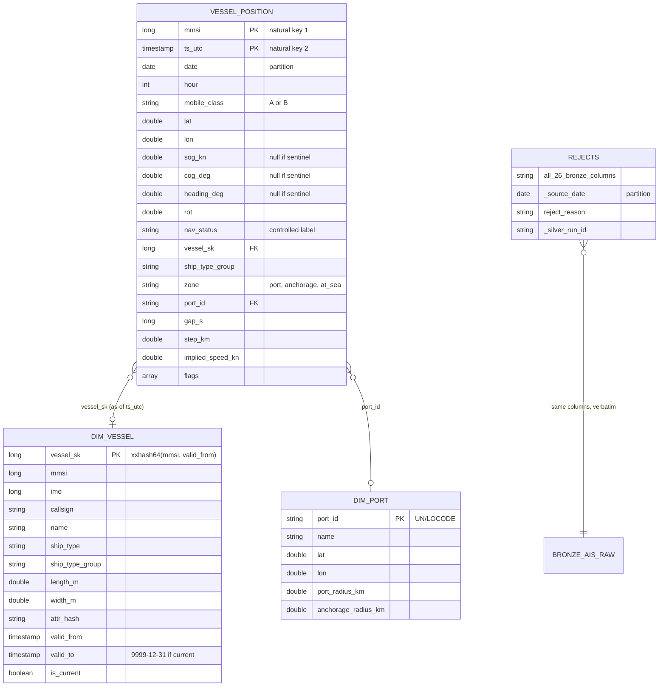

# Silver model

**Grain.** `vessel_position`: one row per `(mmsi, ts_utc)`, guaranteed by conflict resolution
and checked by tests. `dim_vessel`: one row per vessel version; exactly one `is_current` per
mmsi. `dim_port`: one row per port. `rejects`: one row per rejected Bronze row.

**Flow for one date.** Bronze partition → standardise (typed, placeholders to null, labels) →
reject rules (→ `rejects`) → exact dedup → `(mmsi, ts_utc)` conflicts → sentinels →
`dim_vessel` SCD2 merge → movement features (with the previous day's last fix) → zones →
as-of join to `dim_vessel` → `vessel_position` (replaceWhere on `date`).
